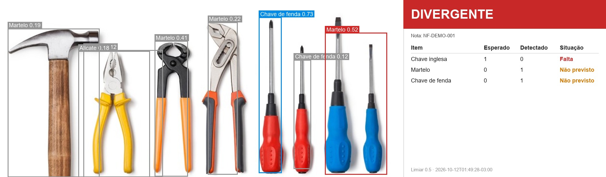

# Conferência visual de recebimento — Desafio Renault 2026

Confere por imagem se os itens fisicamente recebidos batem com a nota fiscal e aponta as divergências.

No recebimento de materiais, alguém precisa contar o que chegou e comparar com a nota. Este MVP automatiza essa conferência: uma foto dos itens recebidos passa por um modelo de visão computacional (YOLO), que detecta e conta cada item. O programa compara as contagens com a nota e gera uma evidência visual e um relatório estruturado.

Neste protótipo, **ferramentas manuais fazem o papel das peças automotivas**. Em produção, o modelo seria treinado com as peças reais. O que se valida aqui é a arquitetura: detecção, comparação com a nota, evidência e contrato de integração.


## Como funciona

```text
foto dos itens ──► modelo YOLO (Roboflow) ──► contagem por item
                                                     │
nota fiscal (JSON) ──► validação + de-para ──────────┤
                                                     ▼
                                   comparação: esperado × detectado
                                                     │
                       ┌─────────────────────────────┴───────────────┐
                       ▼                                             ▼
               relatorio.json                               imagem_anotada.jpg
   (status, linhas, descartadas, avisos)          (caixas + painel com o status)
```

O resultado é sempre um destes três status:

| Status | Quando |
|---|---|
| **CONFORME** | Todos os itens batem com a nota |
| **DIVERGENTE** | Há falta, excesso ou item não previsto na nota |
| **ERRO** | Falha técnica: sem internet, chave inválida, imagem ilegível ou nota inválida. Um erro nunca vira "conforme" |

| Conforme | Vários itens, várias situações |
|---|---|
|  |  |

## Instalação (Windows)

Requer Python 3.10 a 3.13. O `inference-sdk` 1.7.4 não suporta o 3.14, e o projeto foi testado com o 3.12.10.

```bash
git clone https://github.com/EnzoSenatori/DesafioRenault2026.git
cd DesafioRenault2026
python -m venv .venv
.venv\Scripts\python.exe -m pip install -r requirements.txt
```

Copie `.env.example` para `.env` e preencha `ROBOFLOW_API_KEY` com a sua chave do Roboflow. A chave é gratuita, em *Settings → API Keys*. O `.env` não vai para o Git.

## Uso

```bash
.venv\Scripts\python.exe src\conferir.py --imagem "imagens/teste/Img 16.jpg" --nota notas/nota_divergente.json
```

```text
Status: DIVERGENTE  (nota NF-DEMO-002)
  Chave inglesa    esperado  2  detectado  1  falta
Saídas em saidas\20261012_014934_Img_16
```

A pasta de saída guarda o `relatorio.json` e a `imagem_anotada.jpg`.

| Opção | Efeito |
|---|---|
| `--saida PASTA` | Grava os resultados nessa pasta (padrão: `saidas/<data_hora>_<imagem>/`) |
| `--json` | Imprime o relatório completo em JSON em vez do resumo |

Código de saída do processo: `0` conforme, `1` divergente, `2` erro.

### Como biblioteca

```python
import sys; sys.path.insert(0, "src")
from conferir import conferir

relatorio, pasta = conferir("foto.jpg", "nota.json")
print(relatorio["status"])
```

Para um quadro já em memória (array BGR do OpenCV, por exemplo de uma câmera), use `conferir_quadro(imagem_bgr, nota, config)`. Ela devolve o relatório e a imagem de evidência sem gravar nada em disco. Detalhes no [guia de passagem](GUIA_PASSAGEM.md).

### Outros comandos

```bash
# Roda o modelo em todas as imagens de imagens/teste/ (resultado em saidas/fumaca/)
.venv\Scripts\python.exe src\testar_modelo.py

# Testes automatizados (não usam a internet)
.venv\Scripts\python.exe -m pytest
```

## Formatos

**Nota fiscal simulada** (`notas/*.json`):

```json
{
  "nota_id": "NF-DEMO-001",
  "fornecedor": "Fornecedor Exemplo Ltda.",
  "itens": [
    {"codigo": "FER-003", "descricao": "Chave inglesa", "quantidade": 1}
  ]
}
```

Cada código é ligado a uma classe do modelo pelo `de_para` do [`config.json`](config.json):

| Código | Item | Classe do modelo |
|---|---|---|
| FER-001 | Alicate | `Pliers` |
| FER-002 | Chave de fenda | `Screwdriver` |
| FER-003 | Chave inglesa | `Wrench` |
| FER-004 | Martelo | `Hammer` |

Linhas com o mesmo código são somadas. Código desconhecido, quantidade que não seja inteiro positivo ou JSON malformado resultam em `erro`.

**Relatório** (exemplo completo em [`docs/exemplo_relatorio.json`](docs/exemplo_relatorio.json)):

```json
{
  "nota_id": "NF-DEMO-002",
  "status": "divergente",
  "linhas": [
    {"codigo": "FER-003", "item": "Chave inglesa", "classe": "Wrench",
     "esperado": 2, "detectado": 1, "delta": -1, "situacao": "falta"}
  ],
  "descartadas": [],
  "avisos": [],
  "modelo_id": "tools-classification-byznk/2",
  "limiar_confianca": 0.5,
  "gerado_em": "2026-10-12T01:49:34-03:00"
}
```

## Regras da conferência

Para cada item esperado (vindo da nota) ou detectado (com confiança de pelo menos `limiar_confianca`, padrão 0,5), calcula-se `delta = detectado − esperado`:

| Situação | Condição |
|---|---|
| `igual` | delta = 0 |
| `falta` | delta < 0 |
| `excesso` | delta > 0 e o item consta da nota |
| `nao_previsto` | detectado, mas ausente da nota |

Detecções abaixo do limiar não entram na contagem. Elas vão para `descartadas` e aparecem em cinza na imagem. A classe `Fasteners` (parafusos e similares) é ignorada.

## Estrutura

```text
src/
  conferir.py        # CLI e funções de entrada: imagem + nota → relatório + evidência
  detector.py        # chamada ao Roboflow e conversão para o formato interno
  nota.py            # leitura e validação da nota
  comparador.py      # linhas, situações e status global
  visualizacao.py    # caixas e painel (Pillow, para os acentos)
  testar_modelo.py   # teste de fumaça do modelo
tests/               # pytest, sem rede
notas/               # notas de exemplo
imagens/teste/       # imagens de teste
fixtures/            # respostas reais do Roboflow, usadas nos testes
docs/                # imagens e relatório de exemplo
config.json          # modelo, limiar, de-para e nomes em português
```

## Limitações

- **A precisão do modelo nas nossas imagens é baixa.** No teste de fumaça com 21 imagens da internet (fotos de produto, fundo branco, baixa resolução), só 3 tiveram detecções acima de 0,5, e nenhuma foi contada por completo. A métrica publicada (mAP@50 de 98,7%) foi medida no conjunto do próprio autor. O pipeline está correto, mas a precisão depende de um modelo treinado com imagens parecidas com as de uso real. Para trocar de modelo, basta mudar o `config.json`.
- Depende de internet e do plano gratuito do Roboflow, porque a inferência é hospedada.
- Confere uma imagem por vez. Não há vídeo nem contagem acumulada.
- A nota é um JSON simulado. Não há leitura (OCR) de nota real.

## Próximos passos

Estão no [guia de passagem](GUIA_PASSAGEM.md): integração com o restante do sistema, modo câmera e troca de modelo.

## Crédito do modelo

Modelo **"Tools Classification"**, de **proelec3**, publicado no Roboflow Universe sob licença [CC BY 4.0](https://creativecommons.org/licenses/by/4.0/):
https://universe.roboflow.com/proelec3/tools-classification-byznk
(`model_id` `tools-classification-byznk/2`, arquitetura YOLOv8s.)
