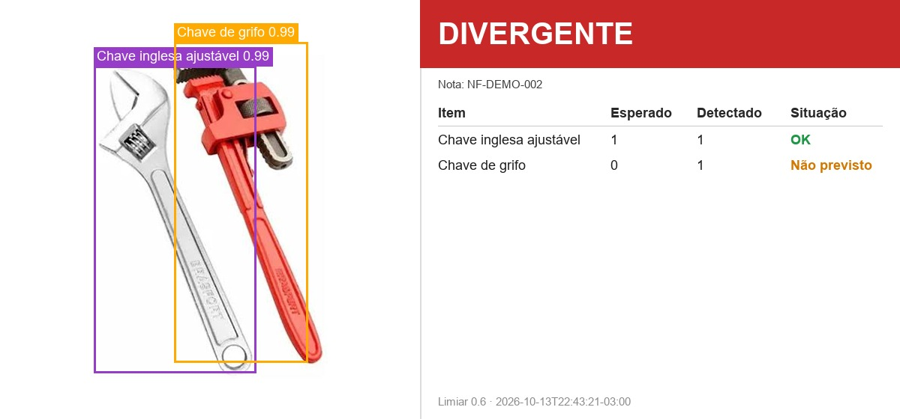
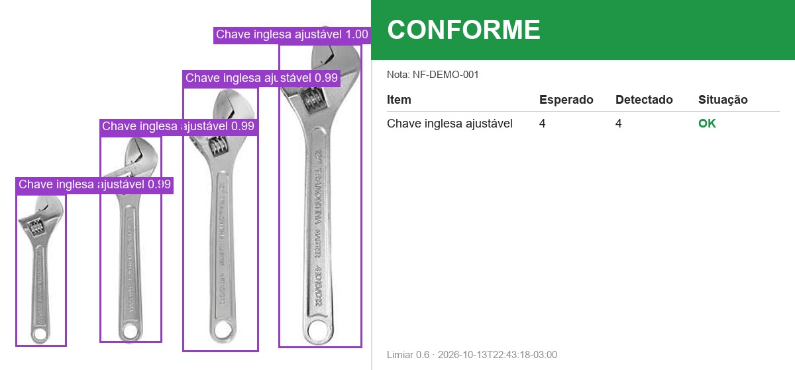

# Conferência visual de recebimento — Desafio Renault 2026

Este protótipo compara itens vistos numa foto ou numa captura de câmera com uma nota fiscal simulada em JSON. Um modelo de detecção hospedado no Roboflow conta ferramentas; o programa gera `relatorio.json` e `imagem_anotada.jpg` com caixas e a comparação entre esperado e detectado. As ferramentas representam peças automotivas nesta prova de conceito; a detecção de peças reais exigirá outro conjunto de dados e validação.



## Estado validado

Rafael escolheu o modelo público **Tool Detection**, de GantrySystem, versão `tool-detection-4u0yd/15`. O gabarito humano de quatro imagens fica em `imagens/teste/gabarito.json`. Na avaliação original, com limiar 0,5, o modelo acertou a contagem inteira em **3 de 4 imagens** e **8 itens**, sem faltas e com **1 excesso**. Na `Img 8.jpeg`, uma única imagem de martelo gerou duas detecções: essa dupla contagem continua sendo uma limitação conhecida. Na `Img 16.jpg`, ele distinguiu corretamente uma chave inglesa ajustável (`Wrench`) de uma chave de grifo (`PipeWrench`). O resultado se aplica apenas às quatro imagens avaliadas e não é uma estimativa de desempenho em uso real. **O limiar atual é 0,6**, escolhido por Rafael após os testes de câmera de 13/10; as métricas originais e os exemplos em `docs/` ainda refletem 0,5.

O mapeamento de nomes brutos do modelo para as classes do projeto está em `aliases_classes` no [`config.json`](config.json). `Adjustable Wrench` vira `Wrench`, `Pipe Wrench` vira `PipeWrench`, os dois tipos de chave de fenda viram `Screwdriver` e `Claw hammer` vira `Hammer`. Outras classes que o modelo detectar não são descartadas: aparecem como itens não previstos quando não constarem da nota.

| Exemplo conforme | Exemplo divergente |
|---|---|
|  |  |

## Instalação no Windows

Use Python 3.10 a 3.13. A execução local foi verificada com Python 3.12.

```powershell
python -m venv .venv
.venv\Scripts\python.exe -m pip install -r requirements.txt
Copy-Item .env.example .env
```

Preencha `ROBOFLOW_API_KEY` no `.env` local. Nunca compartilhe nem publique esse arquivo. A inferência real precisa de acesso ao Roboflow.

## Conferir uma imagem

```powershell
.venv\Scripts\python.exe src\conferir.py --imagem "imagens/teste/Img 15.jpg" --nota notas/nota_conforme.json
.venv\Scripts\python.exe src\conferir.py --imagem "imagens/teste/Img 16.jpg" --nota notas/nota_divergente.json
```

A primeira comparação retorna `conforme`: quatro chaves inglesas ajustáveis na imagem e na nota. A segunda retorna `divergente`: a nota espera uma chave inglesa ajustável, e a foto também contém uma chave de grifo não prevista. Cada execução cria uma pasta em `saidas/` com `relatorio.json` e `imagem_anotada.jpg`. Use `--saida PASTA` para escolher a pasta e `--json` para imprimir o relatório completo. Códigos de saída: `0` conforme, `1` divergente, `2` erro técnico.

## Modo câmera

```powershell
.venv\Scripts\python.exe src\camera.py --nota notas/nota_divergente.json --camera 0
```

A nota é validada antes de abrir a câmera. A prévia mostra uma **borda verde**: coloque os itens inteiros dentro dela. Somente essa área é enviada ao detector; o entorno (por exemplo, teclado e mesa) fica fora da análise. Pressione **espaço** para congelar e conferir um quadro; pressione **Q** para sair. Cada captura cria uma pasta própria em `saidas/camera_<data_hora>/`, contendo `quadro_original.jpg` (foto inteira), `quadro_analisado.jpg` (recorte realmente enviado ao modelo), `relatorio.json` e `imagem_anotada.jpg` (recorte com caixas e painel). O campo `imagem` do relatório continua apontando para a foto inteira. O resultado aparece numa segunda janela e no terminal. Cada foto é contada separadamente, sem acumular quadros. Uma falha de rede gera status `erro` naquela captura e mantém a câmera aberta. Se a câmera não abrir, confira a conexão e as permissões de câmera do Windows. O modo câmera tem testes automatizados sem webcam, e Rafael já verificou que a webcam física abre e salva capturas. A área verde ainda precisa de uma prova prática com o Roboflow; ela foi verificada apenas com uma captura antiga e testes sem rede.

Para testar uma conferência **conforme**, há duas notas prontas: `notas/nota_martelo_camera.json` pede um martelo e `notas/nota_chave_fenda_camera.json` pede uma chave de fenda. Escolha a nota que corresponde à ferramenta mostrada e mantenha apenas essa ferramenta dentro da borda verde. Rafael já obteve uma captura `conforme` com o martelo antes da área verde; o novo recorte precisa de validação prática.

## Caixas abertas e produtos dentro ou fora

Rafael decidiu manter a área verde e o limiar **0,6** e usar dois modelos: um para localizar caixas abertas e o atual para detectar ferramentas. O detector de caixas recebe o recorte verde inteiro. O detector de ferramentas recebe esse recorte e também a parte superior de cada caixa aberta encontrada, para examinar seu interior em maior detalhe. Quando o recorte interno encontra produtos, suas detecções substituem as detecções gerais atribuídas à mesma caixa, evitando dupla contagem. Ferramentas externas permanecem na análise geral. A imagem anotada mostra caixas em azul, com rótulo visível mesmo quando a caixa toca a borda da imagem.

Rafael aprovou o candidato público [Open/closed cardbox](https://universe.roboflow.com/ssh-6xfsh/open-closed-cardbox), versão `open-closed-cardbox/2`; ele está ativo em `modelo_caixas_id` no `config.json`. A classe aceita é `Open Cardboard Box`; caixas fechadas não são associadas a produtos. Cada execução grava `analise_caixas.json`, com as caixas, os produtos associados, os produtos fora e os IDs dos dois modelos. O formato de `relatorio.json` permanece igual. Se qualquer modelo falhar, a conferência retorna `erro`. Para voltar ao modo anterior de um modelo, definir `modelo_caixas_id` como `null`.

Essa associação por posição não prova que o objeto está fisicamente dentro da caixa quando há sobreposição ou oclusão. As capturas em `saidas/` ainda não formam uma avaliação confiável. Para obter um teste útil, fotografar caixas abertas inteiras, vistas ligeiramente de cima, com as ferramentas desobstruídas, além de ferramentas fora da caixa e caixas vazias; conferir manualmente quantidades e posições. Cada captura nova salva `caixa_1_interior.jpg` (e outros índices, se houver mais caixas), que mostra exatamente o recorte enviado ao detector de ferramentas. As métricas publicadas pelo autor do modelo de caixas não são métricas do projeto.

Após uma captura real com um martelo e uma chave de fenda, o detector de ferramentas marcou o martelo três vezes e a chave de fenda três vezes. `src/posprocessamento.py` agora consolida caixas muito sobrepostas ou partes alinhadas de um objeto longo, considerando classe, proporções e posição; também retira um fragmento pequeno no canto quando há uma detecção maior e mais forte da mesma classe próxima. O limiar **não mudou**. A reprodução local das coordenadas dessa captura passou de 3+3 para **1 martelo e 1 chave de fenda**; uma nova inferência real ainda precisa confirmar o resultado. `analise_caixas.json` guarda `deteccoes_suprimidas` com a justificativa e `caixas_ignoradas` para examinar predições de caixa abaixo do limiar ou de outra classe. O relatório acrescenta avisos sem mudar seus campos. Ferramentas distintas muito próximas podem continuar ambíguas; revisar a evidência antes de considerar a conferência validada.

Nas primeiras três capturas, o modelo de caixas retornou **zero caixas abertas aceitas**. Em capturas posteriores, aceitou a caixa em sete fotos, com confiança de 0,70 a 0,86; o antigo rótulo azul ficava escondido na borda. O martelo dentro da caixa estava parcialmente coberto pela parede frontal e foi frequentemente chamado `Mallet`, enquanto a chave de fenda esperada não apareceu claramente no recorte. O novo exame do interior ainda precisa de teste real: os testes automáticos verificam o fluxo e a contagem, não a acurácia do Roboflow. Segmentação não foi adicionada: ela exigiria modelo e dados com máscaras e não corrigiria uma classe errada por si só.

Teste prático sugerido com webcam:

```powershell
.venv\Scripts\python.exe src\camera.py --nota notas/nota_caixa_aberta_demo.json --camera 0
```

Coloque **uma caixa aberta com um martelo dentro** e **uma chave de fenda fora da caixa**, ambos totalmente visíveis dentro da borda verde. Aponte a abertura ligeiramente para a câmera para que a parede frontal não cubra a cabeça do martelo. Pressione espaço uma vez. O esperado, se ambos os modelos acertarem, é `conforme`, uma caixa azul na evidência, um martelo associado à caixa e uma chave de fenda em `produtos_fora` no `analise_caixas.json`. Abra `quadro_analisado.jpg` e `caixa_1_interior.jpg` para confirmar o que os modelos receberam. Pressione Q para encerrar. Se a caixa não for localizada ou houver contagens incorretas, examine os arquivos da pasta nova em `saidas/`; uma captura é diagnóstico, não validação estatística de acurácia.

## Nota, classes e relatório

Exemplo da nota conforme:

```json
{
  "nota_id": "NF-DEMO-001",
  "fornecedor": "Fornecedor Exemplo Ltda.",
  "itens": [
    {"codigo": "FER-003", "descricao": "Chave inglesa ajustável", "quantidade": 4}
  ]
}
```

| Código | Classe interna | Nome exibido |
|---|---|---|
| FER-001 | `Pliers` | Alicate |
| FER-002 | `Screwdriver` | Chave de fenda |
| FER-003 | `Wrench` | Chave inglesa ajustável |
| FER-004 | `Hammer` | Martelo |
| FER-005 | `PipeWrench` | Chave de grifo |

O `de_para` do `config.json` liga cada código à classe interna. Quantidade deve ser inteira e positiva; linhas repetidas do mesmo código são somadas. Código desconhecido ou JSON inválido gera `erro`. O relatório completo de exemplo está em [`docs/exemplo_relatorio.json`](docs/exemplo_relatorio.json).

Para cada classe esperada ou detectada acima do limiar, `delta = detectado − esperado`. `igual` corresponde a zero, `falta` a valor negativo, `excesso` a valor positivo de um item da nota e `nao_previsto` a um item detectado que não consta da nota. O status global é `conforme` apenas se todas as linhas forem iguais; uma diferença gera `divergente`; falhas de imagem, chave, rede ou nota geram `erro`. Detecções abaixo do limiar atual de 0,6 não entram na contagem e são listadas em `descartadas`.

## Integração e testes

Um orquestrador Python pode chamar `conferir()` para arquivos ou `conferir_quadro()` para um quadro BGR em memória. Outras linguagens podem usar a CLI com `--json` e o código de saída, ou ler os arquivos da pasta `--saida`. Antes de construir uma API, é preciso combinar com o colega como o sistema dele entrega imagem e nota e qual retorno espera. O contrato e as perguntas estão em [`CONTINUIDADE.md`](CONTINUIDADE.md).

```powershell
.venv\Scripts\python.exe -m pytest
.venv\Scripts\python.exe src\avaliar_modelos.py --modelos tools-classification-byznk/2 mechanical-tools-83ynn/2 tool-detection-4u0yd/15 tools-v1/1 --mapeamento modelos_avaliacao.json
```

Os testes usam clientes falsos, sem rede nem webcam. A avaliação de modelos usa o gabarito humano e chama o Roboflow. Seus resultados ficam em `saidas/avaliacao/`.

## Arquivos principais

`src/conferir.py` faz a conferência por arquivo e contém o núcleo `conferir_quadro`; `src/camera.py` cuida da captura; `src/detector.py` consulta e normaliza a resposta do Roboflow; `src/caixas.py` consulta os dois modelos e associa ferramentas a caixas; `src/posprocessamento.py` consolida detecções fragmentadas; `src/nota.py` valida a nota; `src/comparador.py` calcula diferenças; `src/visualizacao.py` desenha as evidências; `src/avaliar_modelos.py` compara candidatos com o gabarito. `tests/` contém testes sem serviços externos; `docs/` contém exemplos gerados por execução real.

## Limitações e crédito

A demonstração depende de internet e do serviço Roboflow. As fotos avaliadas não cobrem iluminação, oclusão, câmera, peças reais ou todos os tipos de ferramentas. A dupla contagem do martelo apareceu tanto na `Img 8.jpeg` quanto numa captura de câmera com um martelo e uma chave de fenda: nessa captura, o mesmo martelo recebeu duas caixas com confianças 0,98 e 0,78. Ambas passam pelo limiar 0,6; o filtro geométrico agora tenta consolidar esse tipo de duplicação, mas ainda precisa de nova prova real. Nas capturas com martelo isolado, um falso positivo de chave de fenda 0,52 será descartado pelo novo limiar, mas uma falsa trena 0,91 continuará sendo contada. Um martelo verdadeiro apareceu com 0,73: elevar o limiar a 0,8 o perderia. A confiança é uma pontuação do modelo, não uma garantia de acerto. A nota é JSON simulado; ainda não há leitura de NF-e nem integração com o sistema do colega.

Modelo [Tool Detection, de GantrySystem](https://universe.roboflow.com/gantrysystem/tool-detection-4u0yd), disponibilizado no Roboflow Universe sob [CC BY 4.0](https://creativecommons.org/licenses/by/4.0/). Versão usada: `tool-detection-4u0yd/15`.
